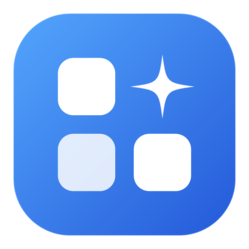
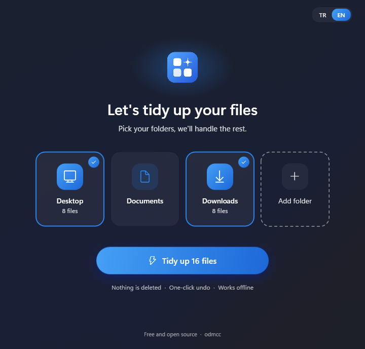
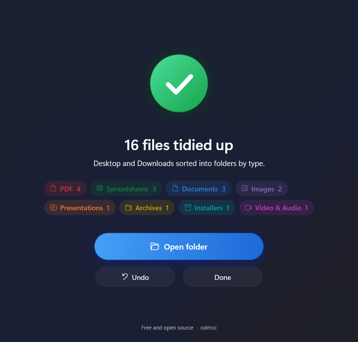

<p align="center">
  
</p>

<h1 align="center">TidyDesk</h1>

<p align="center"><b>A free app for Windows and Mac that tidies up your Desktop, Downloads and Documents in one click.</b></p>

It looks at the files in the folders you pick, figures out what each one is, and sorts them into folders like `PDF`, `Documents`, `Spreadsheets` and `Images`. Nothing is deleted, nothing is uploaded, and every run can be undone with one click.

<p>
  
  
</p>

> Available in **English** and **Turkish**. Switch with the **TR | EN** button in the top-right corner.

## Download

Get one of these from the [Releases](../../releases) page. .NET does not need to be installed.

- **`TidyDesk.exe`** (portable): just run it, from any folder or a USB stick. Leaves no trace outside its own folder.
- **`TidyDesk-Setup.exe`** (installer): adds TidyDesk to the Start menu and to *Installed apps*, so it can be removed the usual way. Installs for your user only, no administrator rights needed.

**Mac:** **`TidyDesk-mac-arm64.dmg`** for Apple Silicon (M1 and later) or **`TidyDesk-mac-x64.dmg`** for Intel Macs. Open the `.dmg` and drag TidyDesk into Applications. See [macOS](#macos) below for the first launch.

**winget:** once the package is accepted into the winget catalog, `winget install odmcc.TidyDesk` installs the same installer.

Windows may show a SmartScreen warning the first time ("Windows protected your PC") because the exe is not code-signed yet (see [docs/SIGNING.md](docs/SIGNING.md)). Click **More info → Run anyway**, or build it yourself from source (see below).

## How it works

1. Run `TidyDesk.exe`.
2. Pick the folders to tidy: Desktop, Documents and Downloads are ready to go. Use **Add folder** to add any other folder, or a whole USB stick. Each card shows how many files will be organized.
3. Optionally pick **Files to move** (all, or only files older than a week, a month, three months or a year) and check **What will move?** for the full list.
4. Press the big button.
5. Open the folder to see the result, or press **Undo** to put everything back. **History** lists earlier cleanups; each one can be undone on its own.

```
Desktop\
├─ Chrome.lnk                ← shortcuts are left alone
├─ My Project\               ← existing folders are left alone
├─ PDF\invoice.pdf
├─ Documents\offer.docx
└─ Spreadsheets\budget.xlsx
```

## Features

- **English and Turkish:** The app starts in Turkish; one click switches to English, and the choice is remembered. Folder names follow the language (`Documents`, `Images`… or `Belgeler`, `Görseller`…).
- **Smart sorting:** Files are sorted by extension into Documents, PDF, Spreadsheets, Presentations, Images, Video & Audio, E-mails, Archives, and Installers. Files that fit no category stay where they are. Files without an extension are recognized by their content (file signature). For example, an extensionless scanned PDF still goes to `PDF`, and renamed Word, Excel and PowerPoint files are told apart.
- **Leaves things alone:** Shortcuts (`.lnk`, `.url`), folders, hidden and system files, unfinished downloads (`.crdownload`, `.part`), Office lock files (`~$…`) and `desktop.ini` are never moved.
- **Skips open files:** Files open in Word, Excel or another program are left where they are.
- **Never overwrites:** If a file with the same name already exists, the new one gets a name like `report (2).pdf`.
- **Undo:** Every move is written to a journal the moment it happens, so undo works even if the app is closed halfway. If a USB stick comes back under another letter or name, undo still finds the files.
- **Subfolders (optional):** On a folder you added yourself, tick **Subfolders too** and every subfolder is tidied in its own place (`Project\2024\report.pdf` → `Project\2024\PDF\report.pdf`). Your folder structure stays as it is. Folders that are already sorted (`PDF`, `Images`…), hidden folders, links, code repositories (`.git`), `node_modules` and Mac app bundles are skipped. Off by default, and never for Desktop, Documents and Downloads.
- **Your own rules:** **Edit rules** opens a copy of the built-in rules (`rules.json` in the data folder). Add categories, extensions or exclusions and save; delete the file to go back to the built-in rules. A file with a mistake is reported and the built-in rules are used.

### Command line

For scripts and scheduled tasks; same rules, same undo history. Without `--folder`, the folders and options chosen in the app are used.

```
TidyDesk.exe --run                         tidy the folders selected in the app
TidyDesk.exe --run --folder "D:\Scans"     tidy this folder instead (repeatable)
TidyDesk.exe --run --subfolders            with --folder: also tidy subfolders, each in place
TidyDesk.exe --run --older-than 30         only files older than 30 days
TidyDesk.exe --run --dry-run               show what would move, move nothing
TidyDesk.exe --undo                        undo the last run
```

`TidyDesk.exe` is a windowed program, so a console doesn't wait for it: in PowerShell run it as `.\TidyDesk.exe --run | Out-Host`, in `cmd` as `start /wait TidyDesk.exe --run`. The command refuses to run while the TidyDesk window is open. On a Mac: `/Applications/TidyDesk.app/Contents/MacOS/TidyDesk --run`.

## Privacy and safety

| | |
|---|---|
| **No network access** | The app contains no networking code: no telemetry, no updates, no uploads. To recognize a file type it reads only the first few bytes, and that data never leaves your computer. |
| **No system folders** | Windows, Program Files, ProgramData, AppData, the Recycle Bin, other users' folders and network paths cannot be selected. On the system drive (`C:`), only folders inside your own user profile are allowed. Other disks and USB sticks can be picked as a whole (`D:\`, `E:\`) or by folder. This is checked both when you pick a folder and again right before files are moved. |
| **Never deletes** | Files are only moved, never deleted. |
| **Top level only** | Only files directly inside the selected folder are touched; subfolders are not scanned. |
| **You decide** | Nothing runs in the background or on a schedule. Files move only when you press the button. |

Desktop and Documents folders redirected to OneDrive or to a network share (Known Folder Move, Folder Redirection) are detected correctly.

## Portable

The points below describe `TidyDesk.exe`. The installer only adds the Start menu entry and the uninstall entry; it still starts nothing on its own and settings stay in `TidyDesk-Data` next to the installed exe.

- Single file: `TidyDesk.exe` (self-contained .NET runtime included).
- Runs from any folder or a USB stick. It does not write to the registry and does not add itself to startup.
- Settings, undo history and logs are stored in a `TidyDesk-Data` folder next to the exe. If that location is read-only, `%LOCALAPPDATA%\TidyDesk` is used instead.
- To remove it, delete the exe and the `TidyDesk-Data` folder.

## macOS

The Mac app works the same way, with the same rules and the same undo. Differences:

- **First launch:** the app is not notarized by Apple (that needs a paid Apple Developer account). macOS says it can't verify the app: press **Done**, open **System Settings → Privacy & Security**, and press **Open Anyway** near the bottom. You only do this once.
- **Folder access:** macOS asks once for each of Desktop, Documents, Downloads and USB drives. If you said no, allow TidyDesk in **System Settings → Privacy & Security → Files and Folders** and reopen the app.
- **Allowed folders:** folders inside your home folder, and external disks and USB sticks under `/Volumes` (whole or by folder). Your home folder itself, `~/Library`, the Trash, system folders (`/System`, `/Library`, `/Applications`…), other users' folders and network volumes are refused. Links are followed to their real target before checking.
- **Left alone:** `.DS_Store`, `._*` files, `.localized`, folder icons and web shortcuts (`.webloc`). Pages and Numbers files are sorted into Documents and Spreadsheets; `.dmg` and `.pkg` go to Installers.
- **Open files:** macOS doesn't lock open files the way Windows does. TidyDesk asks macOS (`lsof`) which files your programs have open and leaves those in place; Office documents are also detected through their `~$` lock files. Programs that read a file and close it again (Preview, TextEdit) can't be detected, so such a file may be moved; Undo puts it back.
- **App menu:** **About TidyDesk** shows the version. Animations follow **Reduce motion** in System Settings → Accessibility → Display.
- **Two downloads:** the Mac app comes as two disk images, one for Apple Silicon and one for Intel. .NET can't build a single universal Mac app, and a home-made workaround can't be tested without a Mac yet.
- **Data:** settings, undo history and logs are in `~/Library/Application Support/TidyDesk`. To remove the app, drag it to the Trash and delete that folder.

## Requirements

Windows 10 or 11, 64-bit. macOS 14 or later (Apple Silicon or Intel).

## Build from source

You need the [.NET 10 SDK](https://dotnet.microsoft.com/download).

```powershell
dotnet test                                                  # run the tests
dotnet run --project src/TidyDesk                    # run the app
powershell -ExecutionPolicy Bypass -File scripts\publish.ps1 # build dist\TidyDesk.exe
```

**Try it safely:** `TidyDesk.exe --demo C:\Temp\Test` runs the app against the `Desktop`, `Documents` and `Downloads` subfolders of `C:\Temp\Test` instead of your real folders.

**winget:** after a release, `powershell -ExecutionPolicy Bypass -File scripts\winget-manifest.ps1 -Version 3.2.0` writes the manifest to `packaging\winget`; check it with `winget validate --manifest packaging\winget\odmcc.TidyDesk\3.2.0` and submit it to [microsoft/winget-pkgs](https://github.com/microsoft/winget-pkgs) (for example with `wingetcreate submit`).

**Mac app:** `dotnet run --project src/TidyDesk.Mac -- --demo /tmp/TidyDeskTest` (the `--demo` option works the same; the Avalonia app also runs on Windows, which helps when trying out the UI). `bash scripts/package-mac.sh 3.2.0 arm64` builds `TidyDesk.app` and `dist/TidyDesk-mac-arm64.dmg`; it needs a Mac. The release workflow builds both Mac disk images on a macOS runner.

### Project layout

| Path | Contents |
|---|---|
| `src/TidyDesk.Core` | Scanning, content-based type detection, folder protection (`PathGuard`), moving and undo. No UI code. |
| `src/TidyDesk.Mac` | Avalonia user interface for macOS. Shares the core and `Strings.cs` with the Windows app. Icons from [Fluent UI System Icons](https://github.com/microsoft/fluentui-system-icons) (MIT, notice in `Icons.cs`). |
| `src/TidyDesk` | WPF user interface (Windows 11 Fluent theme, light and dark mode, respects the Windows animation setting). All UI texts are in `Strings.cs`. |
| `tests/TidyDesk.Tests` | xUnit tests, run on Windows and macOS. Each test uses a temporary folder and never touches real user files. |
| `config/rules.default.json` | Category and exclusion rules (Windows and Mac), embedded into the app |

## Contributing

Issues and pull requests are welcome. Please run `dotnet test` before opening a pull request.

**Adding a language:** all UI texts live in `src/TidyDesk/Strings.cs`. Add your translations there and a button next to **TR | EN**. Category folder names are in `config/rules.default.json`.

## License

[MIT](LICENSE) © odmcc
