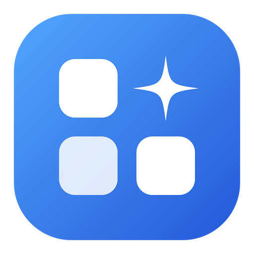
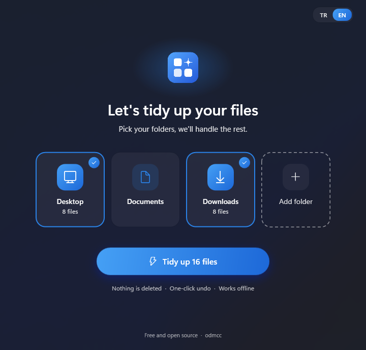
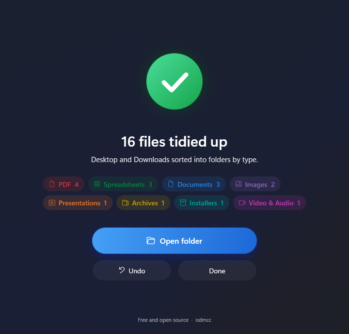

<p align="center">
  
</p>

<h1 align="center">TidyDesk</h1>

<p align="center"><b>A free, portable Windows app that tidies up your Desktop, Downloads and Documents in one click.</b></p>

It looks at the files in the folders you pick, figures out what each one is, and sorts them into folders like `PDF`, `Documents`, `Spreadsheets` and `Images`. Nothing is deleted, nothing is uploaded, and every run can be undone with one click.

<p>
  
  
</p>

> Available in **English** and **Turkish**. Switch with the **TR | EN** button in the top-right corner.

## Download

Get `TidyDesk.exe` from the [Releases](../../releases) page. That's it. There is no installer, and .NET does not need to be installed.

Windows may show a SmartScreen warning the first time ("Windows protected your PC") because the exe is not code-signed yet (see [docs/SIGNING.md](docs/SIGNING.md)). Click **More info → Run anyway**, or build it yourself from source (see below).

## How it works

1. Run `TidyDesk.exe`.
2. Pick the folders to tidy: Desktop, Documents and Downloads are ready to go. Use **Add folder** to add any other folder. Each card shows how many files will be organized.
3. Press the big button.
4. Open the folder to see the result, or press **Undo** to put everything back.

```
Desktop\
├─ Chrome.lnk                ← shortcuts are left alone
├─ My Project\               ← existing folders are left alone
├─ PDF\invoice.pdf
├─ Documents\offer.docx
└─ Spreadsheets\budget.xlsx
```

## Features

- **English and Turkish:** The app starts in Turkish; one click switches to English, and the choice is remembered. Folder names follow the language (`Documents`, `Images`… or `Belgeler`, `Görseller`…).
- **Smart sorting:** Files are sorted by extension into Documents, PDF, Spreadsheets, Presentations, Images, Video & Audio, E-mails, Archives, and Installers. Files that fit no category stay where they are. Files without an extension are recognized by their content (file signature). For example, an extensionless scanned PDF still goes to `PDF`, and renamed Word, Excel and PowerPoint files are told apart.
- **Leaves things alone:** Shortcuts (`.lnk`, `.url`), folders, hidden and system files, unfinished downloads (`.crdownload`, `.part`), Office lock files (`~$…`) and `desktop.ini` are never moved.
- **Skips open files:** Files open in Word, Excel or another program are left where they are.
- **Never overwrites:** If a file with the same name already exists, the new one gets a name like `report (2).pdf`.
- **Undo:** Every move is written to a journal the moment it happens, so undo works even if the app is closed halfway.

## Privacy and safety

| | |
|---|---|
| **No network access** | The app contains no networking code: no telemetry, no updates, no uploads. To recognize a file type it reads only the first few bytes, and that data never leaves your computer. |
| **No system folders** | Windows, Program Files, ProgramData, AppData, drive roots (`C:\`), the Recycle Bin, other users' folders and network paths cannot be selected. On the system drive, only folders inside your own user profile are allowed. This is checked both when you pick a folder and again right before files are moved. |
| **Never deletes** | Files are only moved, never deleted. |
| **Top level only** | Only files directly inside the selected folder are touched; subfolders are not scanned. |
| **You decide** | Nothing runs in the background or on a schedule. Files move only when you press the button. |

Desktop and Documents folders redirected to OneDrive or to a network share (Known Folder Move, Folder Redirection) are detected correctly.

## Portable

- Single file: `TidyDesk.exe` (self-contained .NET runtime included).
- Runs from any folder or a USB stick. It does not write to the registry and does not add itself to startup.
- Settings, undo history and logs are stored in a `TidyDesk-Data` folder next to the exe. If that location is read-only, `%LOCALAPPDATA%\TidyDesk` is used instead.
- To remove it, delete the exe and the `TidyDesk-Data` folder.

## Requirements

Windows 10 or 11, 64-bit.

## Build from source

You need the [.NET 10 SDK](https://dotnet.microsoft.com/download).

```powershell
dotnet test                                                  # run the tests
dotnet run --project src/TidyDesk                    # run the app
powershell -ExecutionPolicy Bypass -File scripts\publish.ps1 # build dist\TidyDesk.exe
```

**Try it safely:** `TidyDesk.exe --demo C:\Temp\Test` runs the app against the `Desktop`, `Documents` and `Downloads` subfolders of `C:\Temp\Test` instead of your real folders.

### Project layout

| Path | Contents |
|---|---|
| `src/TidyDesk.Core` | Scanning, content-based type detection, folder protection (`PathGuard`), moving and undo. No UI code. |
| `src/TidyDesk` | WPF user interface (Windows 11 Fluent theme, light and dark mode, respects the Windows animation setting). All UI texts are in `Strings.cs`. |
| `tests/TidyDesk.Tests` | xUnit tests. Each test uses a temporary folder and never touches real user files. |
| `config/rules.default.json` | Category and exclusion rules, embedded into the exe |

## Contributing

Issues and pull requests are welcome. Please run `dotnet test` before opening a pull request.

**Adding a language:** all UI texts live in `src/TidyDesk/Strings.cs`. Add your translations there and a button next to **TR | EN**. Category folder names are in `config/rules.default.json`.

## License

[MIT](LICENSE) © odmcc
